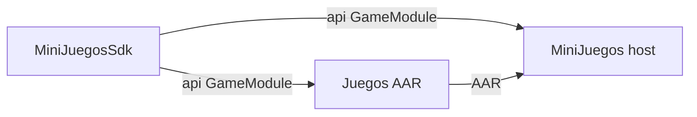
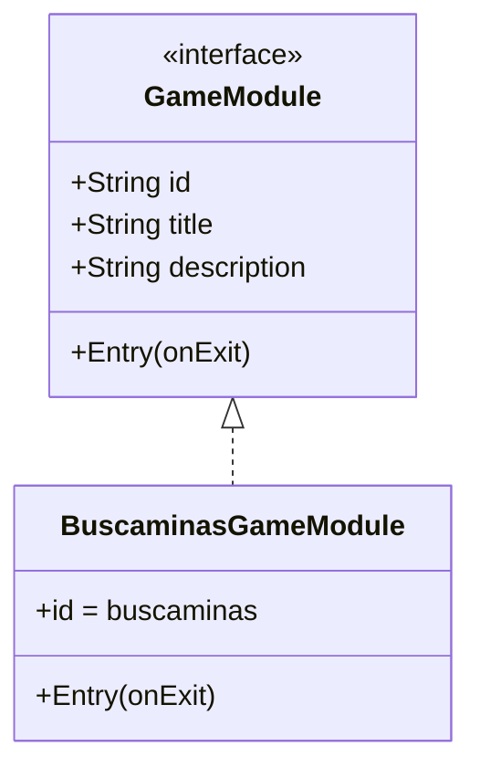
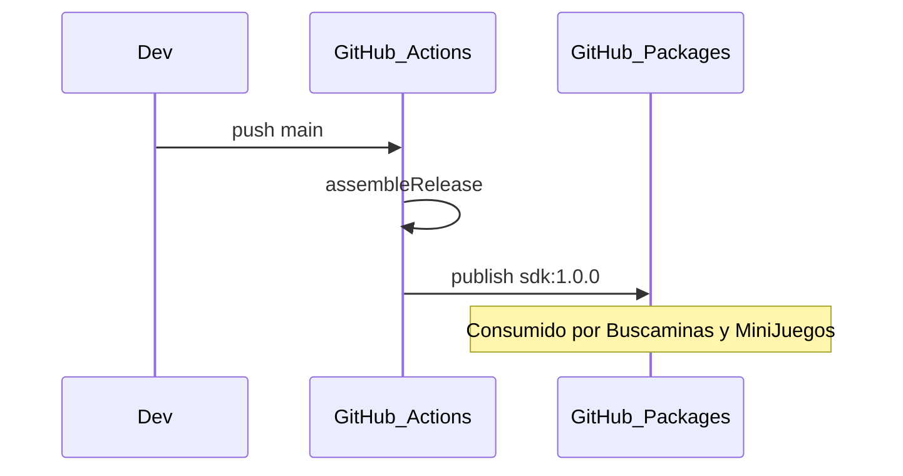

# Estructura — MiniJuegosSdk

## Rol en el ecosistema



Este repo **no** contiene UI de juegos ni el hub. Solo el contrato estable.

## Árbol de módulos

```
MiniJuegosSdk/
├── .github/workflows/ci.yml    # Build + publish a GitHub Packages
├── sdk/                        # android-library → AAR
│   ├── build.gradle.kts
│   ├── consumer-rules.pro
│   └── src/main/
│       ├── AndroidManifest.xml
│       └── java/.../sdk/GameModule.kt
├── build.gradle.kts
├── settings.gradle.kts
└── gradle/
```

## Módulo `:sdk`

| Aspecto | Detalle |
|---------|---------|
| Plugin | `com.android.library` |
| Namespace | `pelkidev.com.mx.minijuegos.sdk` |
| Dependencias | Compose Runtime (mínimo; sin Material) |
| Publicación | `maven-publish` → Maven Local y GitHub Packages |

### Contrato `GameModule`



- `id`: clave estable (`"buscaminas"`).
- `title` / `description`: textos para el hub.
- `Entry(onExit)`: pantalla raíz del juego; `onExit` devuelve al host.

## Flujo de publicación



## Por qué es un repo aparte

1. Cambia poco → menos ruido en los repos de juegos.
2. Host y juegos dependen de la **misma** versión del contrato.
3. Evita duplicar la interfaz en cada proyecto.

## Reglas

- No añadir lógica de un juego concreto.
- No arrastrar Material3 / navegación / analytics.
- Breaking change del contrato = major version.
